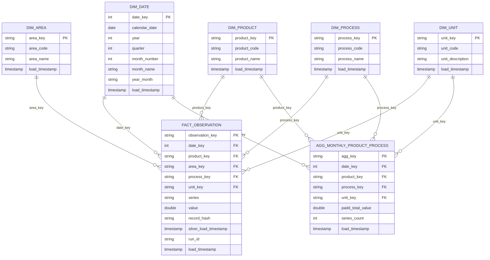

# Gold Layer Data Dictionary — Petroleum Supply Analysis

## 1. Overview

The Gold layer is a **star schema** built from the cleaned Silver table
(`workspace.default.petroleum_silver`). It is designed for analytical
query performance and direct consumption by Power BI.

| Item | Value |
|---|---|
| Catalog / schema | `workspace.default` |
| Table prefix | `petroleum_gold_` |
| Source | EIA Petroleum Supply & Disposition (monthly), via Silver |
| Coverage | January 2005 – January 2026 (monthly observations) |
| Refresh method | Audited Delta `MERGE` (insert new, update changed, skip unchanged) |
| Refresh trigger | End of every pipeline run (`refresh_gold`), from one pinned Silver version |
| Storage format | Delta Lake (Parquet), Unity Catalog managed tables |

### Tables

| Table | Type | Grain | Primary key | Rows* |
|---|---|---|---|---|
| `petroleum_gold_dim_date` | Dimension | One calendar day | `date_key` | 8,035 |
| `petroleum_gold_dim_product` | Dimension | One EIA product code | `product_key` | 58 |
| `petroleum_gold_dim_area` | Dimension | One EIA area (duoarea) code | `area_key` | 12 |
| `petroleum_gold_dim_process` | Dimension | One EIA process code | `process_key` | 7 |
| `petroleum_gold_dim_unit` | Dimension | One measurement unit | `unit_key` | 2 |
| `petroleum_gold_fact_observation` | Fact | One monthly value for one EIA series | `observation_key` | 678,572 |
| `petroleum_gold_agg_monthly_product_process` | Aggregate fact | One month × product × process × unit (PADD 1–5 summed) | `agg_key` | 128,147 |

\*Row counts as of the run on 25 Oct 2026.

---

## 2. Entity-Relationship Diagram

### Relationships

| From (one) | To (many) | Join column | Cardinality |
|---|---|---|---|
| `dim_date` | `fact_observation` | `date_key` | 1 : * |
| `dim_product` | `fact_observation` | `product_key` | 1 : * |
| `dim_area` | `fact_observation` | `area_key` | 1 : * |
| `dim_process` | `fact_observation` | `process_key` | 1 : * |
| `dim_unit` | `fact_observation` | `unit_key` | 1 : * |
| `dim_date` | `agg_monthly_product_process` | `date_key` | 1 : * |
| `dim_product` | `agg_monthly_product_process` | `product_key` | 1 : * |
| `dim_process` | `agg_monthly_product_process` | `process_key` | 1 : * |
| `dim_unit` | `agg_monthly_product_process` | `unit_key` | 1 : * |

The aggregate table has no `area_key`, because it already sums the five
PADD regions.

---

## 3. Key Strategy

| Key | Type | How it is generated | Why |
|---|---|---|---|
| `date_key` | Integer | `yyyyMMdd` of the calendar date (e.g. `20251201`) | Readable, sortable, standard date-dimension convention |
| `product_key`, `area_key`, `process_key`, `unit_key` | SHA-256 string | `sha2(to_json({dimension, code}))` | Deterministic: the same source code always produces the same key, across reruns and environments. The description is excluded, so a renamed label does not change the key |
| `observation_key` | SHA-256 string | `sha2(to_json({period, series}))` | Stable surrogate for the business key `period + series` |
| `agg_key` | SHA-256 string | `sha2(to_json({date_key, product_key, process_key, unit_key}))` | Stable key for the aggregate grain |
| `record_hash` | SHA-256 string | Hash of all foreign keys + `series` + `value` | Change detection: `MERGE` updates a row only when its business content changed |

Processing metadata (`run_id`, timestamps) is never included in any key or
hash, so reruns of unchanged data produce zero inserts and zero updates.

---

## 4. Table Definitions

### 4.1 `petroleum_gold_dim_date`

Continuous daily calendar covering full years, 1 Jan 2005 to 31 Dec 2026.
Monthly observations reference the first day of their month.

| Column | Type | Nullable | Key | Description |
|---|---|---|---|---|
| `date_key` | int | No | PK | Date in `yyyyMMdd` form |
| `calendar_date` | date | No | | Calendar date |
| `year` | int | No | | Calendar year |
| `quarter` | int | No | | Calendar quarter (1–4) |
| `month_number` | int | No | | Month number (1–12) |
| `month_name` | string | No | | Full month name (e.g. `December`) |
| `year_month` | string | No | | `yyyy-MM` label for monthly axes |
| `load_timestamp` | timestamp | No | | UTC time the row was inserted or last changed |

### 4.2 `petroleum_gold_dim_product`

| Column | Type | Nullable | Key | Description |
|---|---|---|---|---|
| `product_key` | string | No | PK | SHA-256 surrogate key |
| `product_code` | string | No | | EIA product code (e.g. `EPPA`) |
| `product_name` | string | No | | EIA product name (e.g. `Asphalt and Road Oil`) |
| `load_timestamp` | timestamp | No | | UTC load time |

### 4.3 `petroleum_gold_dim_area`

| Column | Type | Nullable | Key | Description |
|---|---|---|---|---|
| `area_key` | string | No | PK | SHA-256 surrogate key |
| `area_code` | string | No | | EIA duoarea code (e.g. `R10-Z00`, `NUS`) |
| `area_name` | string | No | | Area label (e.g. `PADD 1`, `U.S.`) |
| `load_timestamp` | timestamp | No | | UTC load time |

> **Note:** EIA uses two codes for each area (for example `R10` and
> `R10-Z00`, both labelled `PADD 1`). Both are preserved as separate
> members. Use `area_code` rather than `area_name` when slicing, so the two
> code families are not summed together. `NUS` / `NUS-Z00` are national
> totals and must not be added to PADD values.

### 4.4 `petroleum_gold_dim_process`

| Column | Type | Nullable | Key | Description |
|---|---|---|---|---|
| `process_key` | string | No | PK | SHA-256 surrogate key |
| `process_code` | string | No | | EIA process code (e.g. `EEX`) |
| `process_name` | string | No | | Activity name (e.g. `Exports`) |
| `load_timestamp` | timestamp | No | | UTC load time |

### 4.5 `petroleum_gold_dim_unit`

| Column | Type | Nullable | Key | Description |
|---|---|---|---|---|
| `unit_key` | string | No | PK | SHA-256 surrogate key |
| `unit_code` | string | No | | `MBBL` or `MBBL/D` |
| `unit_description` | string | No | | `Thousand barrels` or `Thousand barrels per day` |
| `load_timestamp` | timestamp | No | | UTC load time |

Only `MBBL` and `MBBL/D` are accepted. Any other unit fails the load.

### 4.6 `petroleum_gold_fact_observation`

**Grain:** one monthly value for one EIA series.
**Business key:** `period + series` (enforced unique before every load).

| Column | Type | Nullable | Key | Description |
|---|---|---|---|---|
| `observation_key` | string | No | PK | SHA-256 of `period + series` |
| `date_key` | int | No | FK → `dim_date` | First day of the observation month |
| `product_key` | string | No | FK → `dim_product` | Product |
| `area_key` | string | No | FK → `dim_area` | Area |
| `process_key` | string | No | FK → `dim_process` | Process / activity |
| `unit_key` | string | No | FK → `dim_unit` | Measurement unit |
| `series` | string | No | | EIA series ID (e.g. `MAPEXP11`), kept for traceability |
| `value` | double | **Yes** | | Observed value. `NULL` = missing observation, not zero |
| `record_hash` | string | No | | Hash of business content, used for change detection |
| `silver_load_timestamp` | timestamp | No | | When the source row was last written to Silver |
| `run_id` | string | No | | Pipeline operation that last inserted or updated the row |
| `load_timestamp` | timestamp | No | | UTC time the row was inserted or last changed in Gold |

### 4.7 `petroleum_gold_agg_monthly_product_process`

**Grain:** one month × product × process × unit.
Built from the fact table by summing the regional PADD rows (area codes
starting with `R`). National totals (`NUS`) are excluded to avoid double
counting.

| Column | Type | Nullable | Key | Description |
|---|---|---|---|---|
| `agg_key` | string | No | PK | SHA-256 of the four grain keys |
| `date_key` | int | No | FK → `dim_date` | Month |
| `product_key` | string | No | FK → `dim_product` | Product |
| `process_key` | string | No | FK → `dim_process` | Process |
| `unit_key` | string | No | FK → `dim_unit` | Unit (MBBL and MBBL/D never mixed) |
| `padd_total_value` | double | Yes | | Sum of PADD-level values. `NULL` if all inputs are `NULL` |
| `series_count` | int | No | | Number of fact rows combined into this row |
| `load_timestamp` | timestamp | No | | UTC load time |

---

## 5. Modeling Rules

1. Keep `MBBL` (volumes) and `MBBL/D` (daily rates) separate. Never sum across units.
2. Do not sum ending stocks across months. Stocks are semi-additive; use the latest month or an average.
3. Do not add national totals (`NUS`, `NUS-Z00`) to regional PADD figures.
4. Do not add product totals to their own subcategories.
5. Preserve `NULL` values as missing observations, not zero.
6. Preserve every original area code, including codes that share a label.
7. Keep the `series` ID on every fact row for observation-level traceability back to Silver, Bronze, and the raw file.

---

## 6. Load Behaviour and Data Quality

| Check | Where | Action on failure |
|---|---|---|
| Missing or blank dimension codes / descriptions | Dimension preparation | Load fails |
| One code with conflicting descriptions | Dimension preparation | Load fails |
| Unsupported or missing unit | Unit dimension | Load fails |
| Null or duplicate `period + series` | Fact preparation | Load fails |
| Fact row with no matching dimension member | Fact preparation | Load fails |
| Joins change the row count | Fact preparation | Load fails |
| Null or duplicate prepared keys | Before every `MERGE` | Load fails |

- **Dimensions** use SCD Type 1: a changed description overwrites the old one.
- **Fact and aggregate** rows are updated only when their content hash changes.
- All Gold tables are refreshed from **one pinned Silver Delta version**, so dimensions and facts are always consistent.
- Every Gold operation writes one row to `petroleum_execution_logs` with `layer = 'Silver-to-Gold'`, start/end time, `rows_read`, `rows_output`, `rows_aggregated`, `rows_inserted`, `rows_updated`, status, and any error.

---

## 7. Performance Optimization

- `petroleum_gold_fact_observation` uses **Liquid Clustering** on `date_key, product_key, area_key`, the most common Power BI filter and join columns.
- `OPTIMIZE` was run on the fact and all dimension tables.
- Fact preparation uses **broadcast hash joins**: every dimension is small enough to broadcast, so the 678K-row fact side is never shuffled (confirmed in the query plan and Query Profile).

---

## 8. Supporting Operational Tables (used by the BI audit page)

### `petroleum_execution_logs`

| Column | Type | Description |
|---|---|---|
| `log_id` | string | Unique log row ID |
| `run_id` | string | Operation ID |
| `batch_id` | string | Source batch processed |
| `load_type` | string | `full_load` or `incremental_load` |
| `layer` | string | `Raw-to-Bronze`, `Bronze-to-Silver`, `Silver-to-Gold`, or `End-to-End` |
| `source_reference` | string | Source file, table, or Silver version read |
| `target_table` | string | Table written |
| `start_time` / `end_time` | timestamp | Execution window (UTC) |
| `status` | string | `Success` or `Failure` |
| `rows_read` | bigint | Rows read from the source |
| `rows_output` | bigint | Rows prepared for the target (Gold only) |
| `rows_aggregated` | bigint | Rows combined by aggregation (Gold only) |
| `rows_inserted` / `rows_updated` | bigint | `MERGE` results |
| `rows_quarantined` | bigint | Rows rejected to quarantine |
| `error_message` | string | Exception type and message on failure |
| `load_timestamp` | timestamp | When the log row was written |

### `petroleum_quarantine`

| Column | Type | Description |
|---|---|---|
| `quarantine_id` | string | Unique ID |
| `run_id` | string | Operation that rejected the record |
| `batch_id` / `load_type` | string | Batch information |
| `layer` | string | Stage that rejected the record |
| `source_file` | string | Raw file path |
| `record_index` | bigint | Position of the record in the file |
| `raw_payload` | string | Original record as JSON |
| `rejection_reason` | string | Why the record was rejected |
| `load_timestamp` | timestamp | When it was quarantined |
